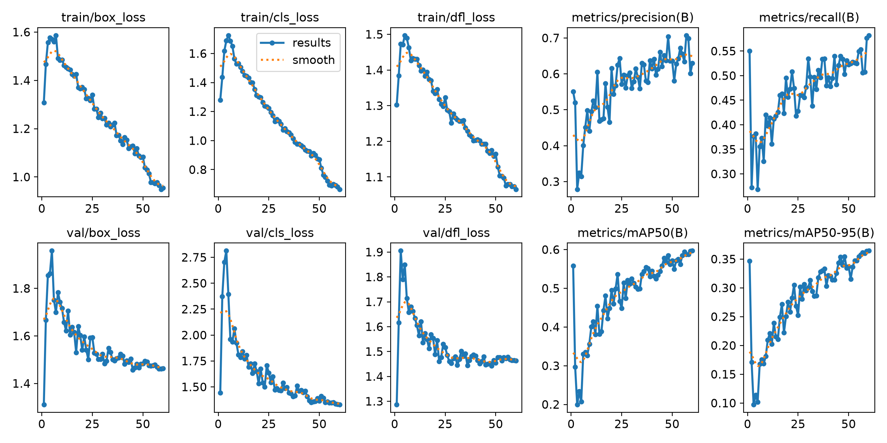
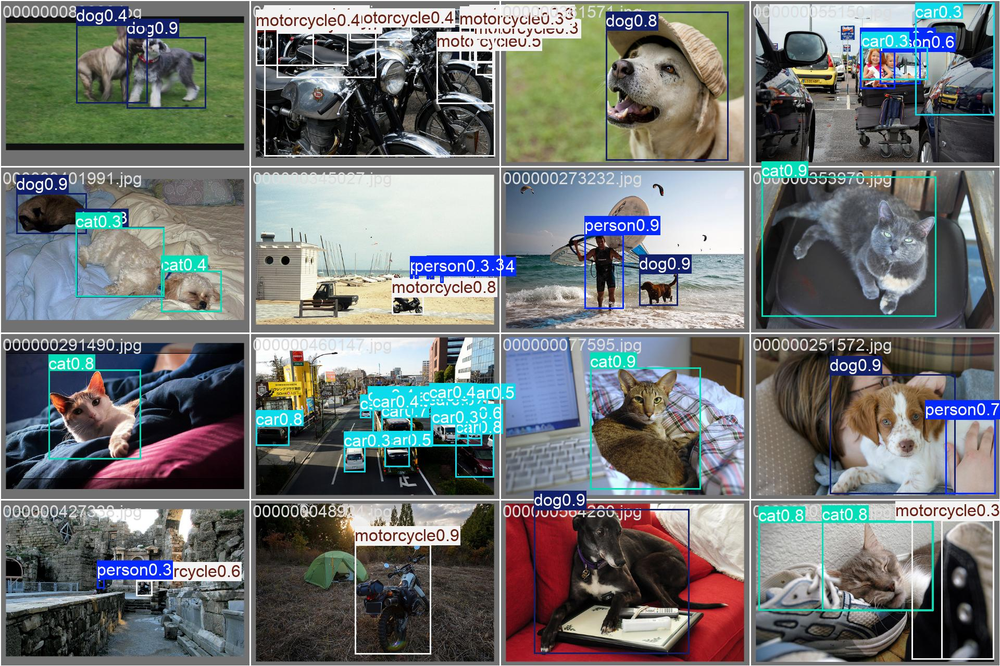
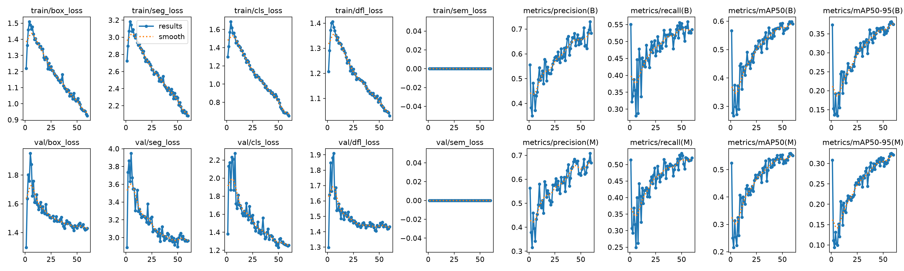
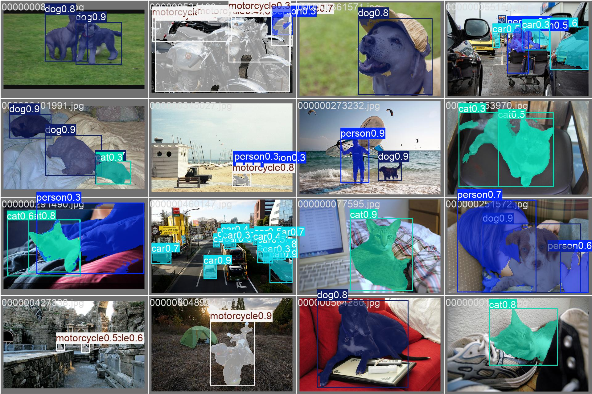
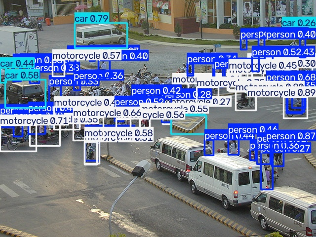
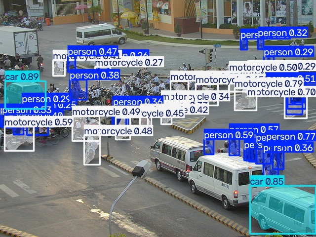
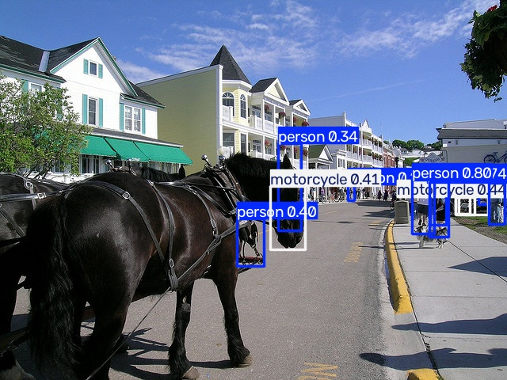
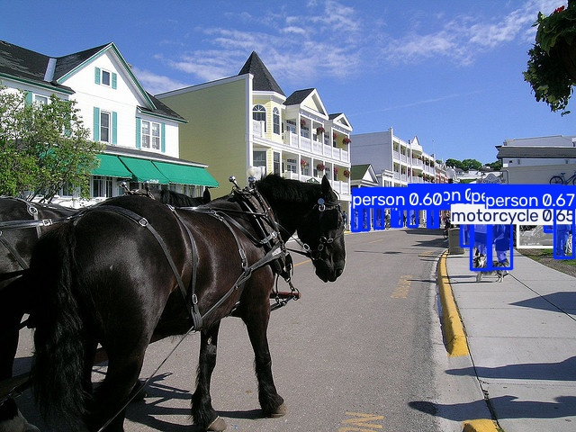

# YOLO Rectangle vs Polygon — 5 คลาส + Web App

**ลองทายรูปเลย →** https://s6806021410132-ops.github.io/yolo-rect-polygon/

Assignment: เทรน YOLO 2 แบบ คือ **Rectangle** (object detection, label เป็นกล่อง) และ **Polygon** (instance segmentation, label เป็นรูปหลายเหลี่ยม)
แล้วเอา weight ของ Polygon ไปทำเป็น Web App ที่รันบนเบราว์เซอร์ทั้งหมด (client-side JS, ONNX Runtime Web)

## Dataset

- 5 คลาส: `person`, `car`, `motorcycle`, `cat`, `dog`
- ภาพจาก COCO 2017 (สุ่มภาพที่มีคลาสเหล่านี้ด้วย seed คงที่) แปลงเป็น YOLO format 2 ชุด จากภาพและ object ชุดเดียวกัน
  - `coco5-det` → `class cx cy w h` (Rectangle)
  - `coco5-seg` → `class x1 y1 x2 y2 ...` (Polygon)
- สคริปต์: [`scripts/build_dataset.py`](scripts/build_dataset.py)

| Split | ภาพ | person | car | motorcycle | cat | dog |
|---|---|---|---|---|---|---|
| train | 878 | 1982 | 914 | 695 | 322 | 320 |
| val | 204 | 448 | 196 | 154 | 66 | 71 |

ทุกคลาสมี object ที่ใช้เทรน **มากกว่า 100 ชิ้น** (น้อยสุด 320)

## การเทรน

- โมเดล: YOLO11n (`yolo11n.pt` / `yolo11n-seg.pt` pretrained) fine-tune 60 epochs, imgsz 640, batch 16
- GPU: RTX 3050 Laptop 4GB (~20 นาทีต่อโมเดล)
- สคริปต์: [`scripts/train.py`](scripts/train.py) (`python scripts/train.py det` / `seg`)

## ผลการเทรน (val 204 ภาพ, 935 objects)

| โมเดล | Box mAP50 | Box mAP50-95 | Mask mAP50 | Mask mAP50-95 |
|---|---|---|---|---|
| Rectangle (det) | 0.598 | 0.366 | – | – |
| Polygon (seg) | 0.599 | 0.382 | 0.562 | 0.326 |

Box mAP50-95 รายคลาส:

| คลาส | Rectangle | Polygon |
|---|---|---|
| person | 0.320 | 0.330 |
| car | 0.288 | 0.323 |
| motorcycle | 0.283 | 0.271 |
| cat | 0.504 | 0.489 |
| dog | 0.436 | 0.497 |

กราฟ/ไฟล์ผลการเทรนอยู่ใน [`results/det`](results/det) และ [`results/seg`](results/seg) (`results.png`, `results.csv`, confusion matrix, PR curve)

### Rectangle



### Polygon



## ผลการ Predict

รูป val 12 รูป ทายด้วยทั้งสองโมเดล (conf 0.25): [`results/det/predict`](results/det/predict), [`results/seg/predict`](results/seg/predict)

| Rectangle | Polygon |
|---|---|
|  |  |
|  |  |

## Weights

| ไฟล์ | |
|---|---|
| [`weights/yolo11n-det-coco5.pt`](weights/yolo11n-det-coco5.pt) | Rectangle (PyTorch) |
| [`weights/yolo11n-seg-coco5.pt`](weights/yolo11n-seg-coco5.pt) | Polygon (PyTorch) |
| [`weights/yolo11n-det-coco5.onnx`](weights/yolo11n-det-coco5.onnx) | Rectangle (ONNX) |
| [`weights/yolo11n-seg-coco5.onnx`](weights/yolo11n-seg-coco5.onnx) | Polygon (ONNX, ใช้ใน web app) |

```python
from ultralytics import YOLO
YOLO("weights/yolo11n-seg-coco5.pt").predict("your.jpg", save=True)
```

## Web App (ของแถม)

อยู่ในโฟลเดอร์ [`docs/`](docs) — host ด้วย GitHub Pages
- โหลด ONNX แล้วรันด้วย `onnxruntime-web` (WASM) บนเครื่องผู้ใช้ ไม่มีการส่งรูปไปเซิร์ฟเวอร์
- เลือกรูป / ถ่ายรูปจากมือถือ / ลากวาง / วาง (paste) ได้
- สลับโมเดล Polygon ↔ Rectangle, ปรับ confidence / IoU ได้แบบ real-time
- เขียน pre/post-processing เอง: letterbox → YOLO11 output decode → NMS → mask = sigmoid(coef · protos) ครอปตามกล่อง

รันในเครื่อง: `python -m http.server -d docs` แล้วเปิด http://localhost:8000

## ทำซ้ำทั้งหมด

```bash
pip install ultralytics onnx onnxslim
# ดาวน์โหลด annotations_trainval2017.zip แตกไว้ที่ raw/annotations
python scripts/build_dataset.py
python scripts/train.py det
python scripts/train.py seg
python scripts/predict_export.py
```

ภาพจาก [COCO dataset](https://cocodataset.org) (CC BY 4.0 annotations, ภาพจาก Flickr ตาม license ของแต่ละภาพ)
